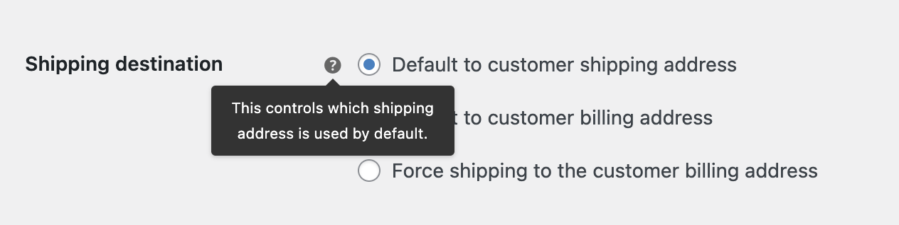

# Remove WooCommerce Billing Address Fields for Free Checkout #

A free digital product should show no payment gateway.

It can be a hassle to fill out your billing address if you aren't actually paying any money. This plugin removes the billing address fields from WooCommerce checkout when no shipping is required and the cart total is 0, ie: Free. 

Specifically the following fields are removed:

1. billing_address_1
1. billing_address_2
1. billing_city
1. billing_state
1. billing_postcode
1. billing_country
1. billing_phone

That's it!

### Support ###

Support is handled in the [WordPress forums](http://wordpress.org/support/plugin/remove-woocommerce-billing-address-fields-for-free-checkout). Please note that support is very limited. Before posting a question, please confirm that the problem still exists with a default theme and with all other plugins disabled.

Please report any bugs, errors, warnings, code problems to [Github](https://github.com/helgatheviking/wc-remove-billing-address-fields/issues)

## Installation ##

1. Upload the `plugin` folder to the `/wp-content/plugins/` directory
1. Activate the plugin through the 'Plugins' menu in WordPress

## Screenshots ##

# Donations #
**Support my team:** https://www.paypal.com/fundraiser/charity/1451316  

## Variables

### Shipping destination

> This controls which shipping address is used by default.

`wp-admin/admin.php?page=wc-settings&tab=shipping&section=options`

`wp option get woocommerce_ship_to_destination`

|	Shipping destination | value        |
|	-- |--------------| 
| Default to customer shipping address | shipping     |
| Default to customer billing address | billing      |
| Force shipping to the customer billing address | billing_only |

### Product properties

|   | Free              | Paid                       |
|---|-------------------|----------------------------|
| Virtual | No address at all | No billing address for CoD |
| Shipped | Shipping only     | Shipping only              |

`wp product create --name="example-product" "--regular_price=0.00 --virtual=true`

* WooCommerce already hides the shipping address for virtual products
* With $0 checkout WooCommerce already assigned no payment gateway to the order
